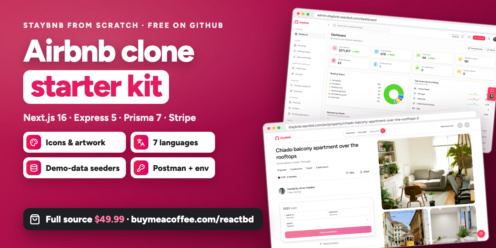
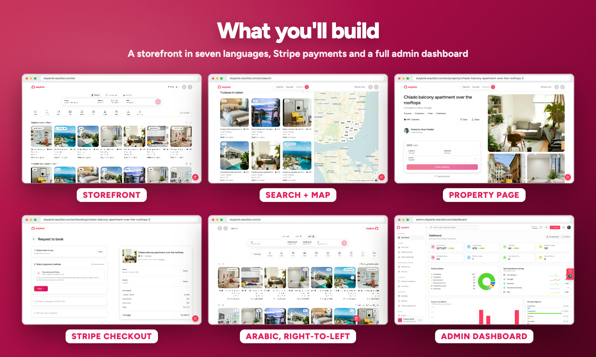

<p align="center">
  <a href="https://buymeacoffee.com/reactbd/e/548868"></a>
</p>

<h1 align="center">Staybnb Starter Kit</h1>

<p align="center">
  <b>Free icons, artwork, translations, demo data and env templates for <i>Staybnb from Scratch</i></b><br>
  the 6.5-hour course where you build a full Airbnb clone with Next.js 16, Express 5, Prisma 7 and Stripe.
</p>

<p align="center">
  <a href="https://buymeacoffee.com/reactbd/e/548868"></a>
  <a href="https://staybnb.reactbd.com"></a>
  <a href="https://www.youtube.com/@reactjsbd"></a>
</p>

<p align="center">
  
  
  
  
  
  
  
  
  
  
</p>

> [!IMPORTANT]
> **This kit holds the materials, not the app's code.** The course types every file with you. If you'd rather start from the finished, ready-to-deploy monorepo (storefront, admin dashboard and API), **[get the full Staybnb source for $69.99 →](https://buymeacoffee.com/reactbd/e/548868)**

## What you'll build

<p align="center">
  
</p>

- **A REST API:** sign-up and Google sign-in, five roles, photo uploads, listings, bookings with an availability lock, Stripe Checkout with a signed webhook, a wallet ledger, reviews, chat that lives with a booking, experiences and services, and a full admin API
- **A server-rendered storefront** in seven languages (right-to-left included): search with a map, the property page, a four-step checkout, trips, wallet, become a host and an 18-step listing wizard
- **An admin dashboard:** moderation, people, bookings, the catalogue, the support inbox and a read-only preview role
- **Tests** (Jest, Supertest and a 56-step journey) and a production deploy on Vercel and Neon

## What's in this kit

Some things can't sensibly be typed along: icons, artwork, translations and a whole demo dataset. They're here.

| | |
| --- | --- |
| [`drop-in/`](drop-in) | Everything the course **copies** instead of typing, one folder per part, laid out like the project. |
| [`env/`](env) | `.env` templates for the API, the storefront and the admin, with local defaults filled in and every secret left blank. |

| Part | Folder | What's in it |
| ---- | ------ | ------------ |
| 20 · Swagger, Postman and a full demo dataset | [`part-20-demo-data-and-postman`](drop-in/part-20-demo-data-and-postman) | 18 files: the seeders for the demo dataset (listings, experiences, services, reviews, a curated photo pool) and the Postman generator, with a ready-made collection |
| 23 · The storefront: Next.js 16 and the design tokens | [`part-23-storefront-icons-and-art`](drop-in/part-23-storefront-icons-and-art) | 22 files: favicons, app icons, the logo, the web manifest and the 404 artwork |
| 24 · Seven languages, right-to-left, and the proxy | [`part-24-translations-and-error-page`](drop-in/part-24-translations-and-error-page) | 7 files: six translations (Arabic, Bengali, Spanish, French, Italian, Urdu) and the illustrated 500 page |
| 42 · The admin dashboard: Vite 8, React 19 and shadcn | [`part-42-admin-icons`](drop-in/part-42-admin-icons) | 14 files: the admin's favicons, app icons, logos, manifest and placeholder image |
| 45 · The dashboard page: revenue, bookings and activity | [`part-45-dashboard-sample`](drop-in/part-45-dashboard-sample) | 1 file: sample numbers for the dashboard's demo switch |

## How to use it

Type along with the course. When a part says **"from the starter kit"**, copy that part's folder over your project, so every file lands in the right place:

```bash
git clone https://github.com/noorjsdivs/staybnb-starter-kit.git
cp -R staybnb-starter-kit/drop-in/part-23-storefront-icons-and-art/. ~/code/staybnb/
```

Copy each env template next to its app, without `.example`, then fill it in as the course creates each account:

```bash
cp staybnb-starter-kit/env/apps/api/.env.example                 ~/code/staybnb/apps/api/.env
cp staybnb-starter-kit/env/apps/web/.env.development.example     ~/code/staybnb/apps/web/.env.development
cp staybnb-starter-kit/env/apps/admin/.env.development.example   ~/code/staybnb/apps/admin/.env.development
```

### Accounts you'll need

| Need | Why | Cost |
| --- | --- | --- |
| Node 22.12+, pnpm 12, Git, VS Code, Docker Desktop | the toolchain, and Postgres 17 on port 5434 | free |
| Stripe (test mode) + the Stripe CLI | Checkout, the webhook, wallet top-ups (and the API tests in part 21) | free |
| ImageKit | photo uploads (the demo data uses hosted photos) | free tier |
| Firebase project | Google sign-in (the API verifies the token, then issues its own JWT) | free tier |
| A mailbox with SMTP (Gmail app password, Mailtrap or Resend) | verification links and reset codes; without it the API prints them in its terminal | free tier |
| Neon + Vercel | production, in the last part | free tiers |

## Good to know

- **Keep your keys out of Git.** In the video the `.env` lines in each `.gitignore` are commented out. Make them active in your project (`.env`, `.env.*` and `!.env*.example`) so a real key never reaches GitHub.
- **Demo logins.** The seed creates an admin (`admin@staybnb.com`) and a cast of guests and hosts (`…@staybnb.test`); their local passwords are in `part-20-…/apps/api/scripts/import-mock.ts`. They're for your machine only: never seed a production database with them.
- **The 500 page** reuses the 404 page's artwork, so it needs the part 23 folder too.
- **Photos** in the demo data load from Unsplash, Pravatar and Picsum, under their own terms.

## Get the code

| | Full source | Done-for-you launch | Custom marketplace |
| --- | :---: | :---: | :---: |
| **Price** | **$69.99** one-time | **$399** | from **$999** |
| **What you get** | The complete Turborepo monorepo (web, admin, API), the Prisma schema, migrations and seed data, Stripe, uploads and OAuth ready to configure | Staybnb set up, configured and live on your domain: payments, env and deploy included | Features scoped to your business, built for you |
| **You handle** | setup, config and hosting | nothing | the brief |
| | **[Get the source →](https://buymeacoffee.com/reactbd/e/548868)** | [Book the launch →](https://buymeacoffee.com/reactbd/e/558771) | [Get in touch →](https://www.reactbd.com/contact) |

Instant access after purchase, with a perpetual license. Deploy it yourself, exactly like the [live demo](https://staybnb.reactbd.com).

## License

The kit is free for learning and for building your own projects, personal or commercial. Please don't resell or re-publish it as a template or course of your own. See [LICENSE](LICENSE).

<p align="center">
  Made by <a href="https://reactbd.com">ReactBD</a> · <a href="https://www.youtube.com/@reactjsbd">YouTube</a> · <a href="https://medium.com/@reactbd">Medium</a> · <a href="mailto:reactjsbd@gmail.com">reactjsbd@gmail.com</a><br>
  If the course helped you, a ⭐ on this repo helps others find it.
</p>
